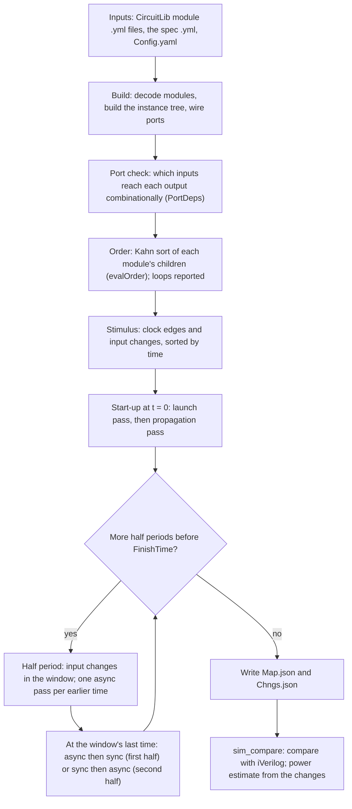
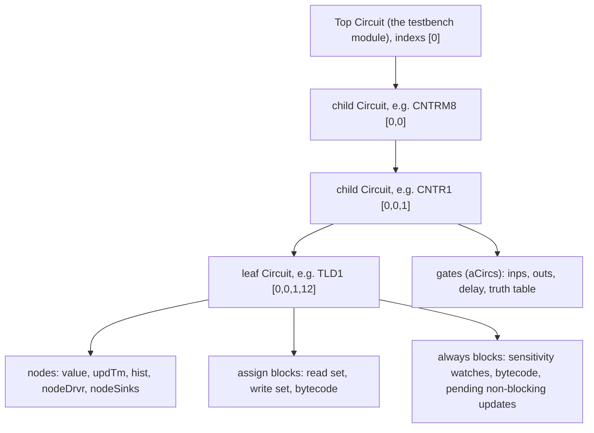
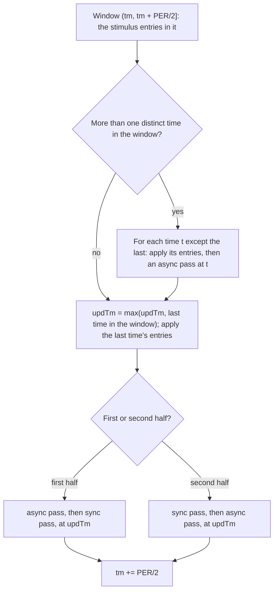
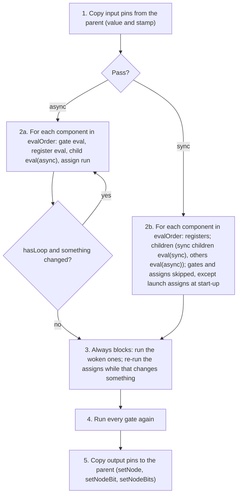

# SimRun: the simulation algorithm, step by step

**Master copy:** `/home/Dropbox/programming/Swift/TwosCmplt/SIMULATION_ALGORITHM.md`.
A copy is kept in SimLib (`/home/martin/IC_Design/Testbenches/NgSpice/SimLib/SIMULATION_ALGORITHM.md`);
edit the master and copy it over.

**Describes:** TwosCmplt commit `0db46e9`, branch `swift-compat-input-times`.
**Written:** 2026-10-29. **Plan:** `~/.claude/plans/happy-mapping-ladybug.md`.

## 0. Purpose and how to use this document

This document describes, step by step, how SimRun (the Swift simulator in
TwosCmplt) simulates a digital circuit. It is written so that:

- **another simulator** (in Julia, Python, C++, …) can be built from it
  without reading the Swift code, and produce the same output files;
- **any simulator** can be checked against it: §10 gives the test procedure,
  the pass criteria and the expected results.

**Status.** Every step below refers to the code at TwosCmplt commit
**`0db46e9`** (branch `swift-compat-input-times`), as `file:line` under
`Sources/TwosCmplt/` unless another directory is named. If the code changes,
the references and this document must be updated together.

**Words used.**
- *Module*: a circuit definition (one `.yml` file in CircuitLib).
- *Instance*: one use of a module inside another, with a name, e.g.
  `CNTRM8.CNTR1`.
- *Leaf cell*: a module with no child instances, only behaviour (gates,
  assigns, always blocks), e.g. `DG_NAND2_2X1`, `DG_TDER_6X2`.
- *Composite*: a module with child instances, e.g. `CNTRE4`.
- *Node*: a net, of 1 or more bits, inside one module instance. A bus is one
  node.
- *Pin* (port): a named connection of a module; inside the module it is a
  node, and outside it is connected to a node of the parent.
- *Pass*: one evaluation of the whole circuit tree, either *async* or *sync*
  (§7).
- *Sweep*: the passes made for one half period of the clock (§7.2).
- *Stamp*: the time (integer ps) a node change is recorded at.

---

## 1. Overview



**In words.**
1. **Inputs** (§2): each module is a YAML file in `Resources/CircuitLib`,
   produced from Verilog by verilogParse (§9). The spec gives the clock(s),
   the input changes and the finish time.
2. **Build** (§5.1–5.2): the top module and every module it uses are decoded;
   one `Circuit` object is made per instance, with its nodes, gates, assigns,
   always blocks and children, and the ports are wired to the parent's nodes.
3. **Port check** (§5.3): for every module, which input pins reach each output
   pin through combinational logic only. Registers cut a path. This also
   checks that every loop goes through a register (or two latches of opposite
   phase), and reports any that doesn't.
4. **Order** (§5.4): each module's children are sorted so that a child comes
   after every child that drives one of its inputs combinationally (Kahn's
   algorithm). A real loop keeps the old fallback: declaration order with
   repeated passes.
5. **Stimulus** (§2.2): the clock is expanded into edges; with the spec's
   input changes, they form one time-sorted list.
6. **Start-up** (§7.1): registers take their initial values and drive them out
   (launch), then the combinational logic is evaluated once in order
   (propagation).
7. **Half periods** (§7.2): time advances in windows of half a clock period.
   Inside a window, input changes at earlier times get their own async pass;
   at the window's last time an async and a sync pass run, in an order that
   depends on the half.
8. **Output** (§8): every node change ever recorded, in the order written, is
   saved as `<TB>Chngs.json`, with the instance and node names in
   `<TB>Map.json`.
9. **Use** (§9, §10): SimLib's `sim_compare.py` compares the result with
   iVerilog's (converted to the same format), and the power estimate
   charges each recorded change.

---

## 2. Inputs

### 2.1 A module: `Resources/CircuitLib/<module>.yml`

Produced by verilogParse (§9.1); one file per module. Decoded into a `CircDef`
by `makeCircDef` (`CircDef.swift:167`). The top-level keys:

| Key | Meaning |
|---|---|
| `kind` | `verilog` for every module produced by the pipeline. (`subcirc` is an older native gate-level format, used only by `CNTR3`, `CNTR4`, `JKFF`.) |
| `module` | the module name |
| `params` | a list of `{kind, name, value}`; always includes `circuit` (see below) and usually `delay` |
| `io_ports` | the pins, in Verilog port order; each `{name}` (leaf cells) or `{kind, name, direct: 'Input:'/'Output:', width}` |
| `decls` | declarations: `Input`, `Output`, `Wire`, `Reg`, `Integer`, each with `width` `[msb, lsb]` |
| `behav_blcks` | the module's contents, in source order (below) |

**`behav_blcks` entries**, by `kind`:

| `kind` | What it is | Fields |
|---|---|---|
| `assign` | a continuous assign | `lvalue`, `rvalue` (an expression tree), `delay` |
| `always` | an always block | `onlyif`: the sensitivity list, each `{edge: posedge/negedge/all/level, node}`; `stmnts`: statements (`ifst`, `blckst` blocking, `noblckst` non-blocking, `casest`, loops) |
| `initial` | an initial block | `stmnts` |
| `gate` | a Verilog gate primitive | `gate` (`not`, `buf`, `nand`, …), `ports` `[out, in…]`, `delay` (e.g. `11.8*1.0`) |
| `async`, `sync`, `subcirc`, `instance` | a child instance | `name`, `module`, `params` (instance overrides, e.g. `circuit`), `ports`: each `{port: <name or None>, node: <ident / bit / slice / concat>}`; `None` means "by position", following the child's `io_ports` |
| `specify` | a specify path, e.g. `(CP, CN, L, … *> QP, QN) = delay` | `src_sgnls`, `dst_sgnls`, `delay_expr` |

**The `circuit` parameter.** Every instance must end up with `circuit` =
`sync` or `async`, from the instance's own parameters or else the module's
(`CircDef.swift:1084–1090`; anything else stops the build). `sync` means "contains registers". verilogParse writes
`subcirc` for a composite that contains registers (`circuit_defaults.py`), and
rewrites `value: subcirc` to `value: sync` when it copies the module into
CircuitLib (`~/.xschem/verilogParse/lib/utils.py:734`). So in SimRun every
composite with registers anywhere inside is `sync`. Since `0db46e9` the
evaluation order does not depend on this label (§5.4); it still decides how a
child is evaluated in a sync pass (§7.3).

**Supply pins** `VDD`, `VSS` (often as a concat `{VDD, VSS}`) are skipped when
wiring; inside a cell, `VDD` reads 1 and `VSS` reads 0.

**Expressions** (`rvalue`, conditions) are trees of `ident`, `int`, `float`,
`bit`/`slice` (a select), `uexpr` (unary: `Unot:` …), `bexpr`/`gt_expr`/
`cmpr_expr` (binary: `BAnd:`, `BOr:`, `BXor:`, `BEq:`, `BNotEq:`, `BPlus:` …),
`cmpr_ident` (an identifier as a condition), `cmpr_gate` (a gate expression as
a condition), `cndexpr` (`? :`), concatenations, and system calls (`$time`).
They are decoded into the `Expr` enum (`CircuitParse.swift:492`) and compiled
to bytecode for a small stack machine (`Compile.swift`, `run` in
`Sim.swift:1340`).

### 2.2 The stimulus: the spec `.yml`

Passed with `--spec <path>`; by default `Resources/SimSpcs/<TB>.yml`. SimLib's
`run_sim_ui.py` writes the Swift spec from the iVerilog spec
(`SimLib/Testbenches/<TB>/VerilogSpecs/<TB>.yml`). Decoded by `SpecStruct`
(`Sim.swift:80`):

| Key | Read by SimRun | Meaning |
|---|---|---|
| `Constants` | yes | must contain `PER`, the clock period in ps |
| `FinishTime` | yes | an expression in `PER`, e.g. `24*PER` |
| `Clock` | yes | a list of `{clkNm, per, initVal (default 0), delay (default 0)}` |
| `TimeSpcs` | yes | a list of `{tm, vls: [[signal, value], …]}`; `tm` an expression in `PER`; a value an integer, or a string like `'0x70'` |
| `SaveNds` | decoded | output formatting for the viewer, not used by the simulation |
| `ResetRelease`, `Signals`, `Classifications`, `module`, `generated` | no | used by run_sim_ui and the power estimate, not by SimRun |

**Clock expansion** (`genClkChngs`, `Sim.swift:607`): a record of `initVal` at
t = 0, then the first edge at `delay + per/2`, and an edge every `per/2` up to
`FinishTime`. With `initVal` 0 and `delay` 0, the clock rises at `PER/2` and
falls at `PER`.

**The stimulus list** (`loadSpecs`, `Sim.swift:1574`): the clock edges and the
`TimeSpcs` entries are merged into one list sorted by time.

### 2.3 `Config.yaml`

Gives the dump directory (`directories.dumpDir`) and the release binary
(`fileNames.simRunner`). **The CircuitLib directory is fixed** at
`Resources/CircuitLib` under the source tree (`Glbls.circLibDir`,
`Glbls.swift:98`); `directories.circLib` is not used.

### 2.4 The command

```
SimRun <TB> Config.yaml --spec <spec.yml>
```

`Examples/SimRun/SimRun.swift`: `makeCircDef` (line 45) → `toCircuit()` (50)
→ `saveDefMap()` → `loadSpecs` (63) → `simCircuit` (69) → `saveNodeChngs()`
(72).

---

## 3. Data model



**One `Circuit` per instance** (`Circuit.swift`, `public final class
Circuit`). Its fields that matter here:
- `module`, `name`, `kind`, `sync` (§2.1), `parent`, and `indexs`: the
  instance's path as child indices, `[0]` for the top (`getIndxs`). This path
  is the `circIndxs` of every record it writes (§8).
- `nodes: [Nod]` and `nodeLU: [name: index]`.
- `iPrts`, `oPrts: [PortDef]`: each pin's internal node (`intlIndx`) and the
  parent's node (`extlIndx`). An output pin that drives part of a parent bus
  has `extlBitIndex` (one bit) or `extlBitRange` (`msb`, `lsb`).
- `aCircs: [Gate]` (gate primitives), `sCircs: [Reg]` (registers of the native
  format only), `cCircs: [Circuit]` (child instances).
- `assgnBlkReads`, `assgnBlkWrites`: per continuous assign, the nodes it reads
  and writes (`CircDef.swift:1287–1297`).
- `alwaysStates`: per always block, its pending non-blocking updates and its
  `trigTm` (the time of the change that last woke it).
- `evalOrder: [CmpRef]` and `hasLoop` (§5.4).

**A node** (`Nod`, `Node.swift:3`):
- `node`: the value, a two's-complement integer of `nbits` bits;
- `updTm`: the stamp of its latest change;
- `hist`: up to 4 earlier `(tm, value)` pairs (`histDepth`), so a node can be
  read as it was at an earlier time (`value(at:)`, `Node.swift:29`);
- `nodeDrvr`: the component that drives it (set when wiring);
- `nodeSinks`: the components that read it;
- `capac`: a capacitance weight, written into each record (§8).

---

## 4. Value model

- **Two-state.** Every bit is 0 or 1; there is no x or z.
- **Every node starts at 0, stamped 0** (`Nod.init`, `Node.swift:41` on).
  `integer` variables start at 0 too (`persistentVars`).
- **Widths** come from the declarations; values are masked to the width by
  `TwoCmplt`.
- **Consequence: a first value equal to 0 is never recorded, and keeps stamp
  0.** A gate reading such a node takes 0 as the node's time. Example
  (TST_CNTRM8): net `CNTRM8.CNTR1.CNTN` is first computed as 0 at 56 ps (from
  pin `CNT` = 1), equal to its start value, so it keeps stamp 0;
  `CNTRM8.CNTR1.NOR1` then stamps `T1` = 1 at 0 + 14 = 14 ps. iVerilog has
  `CNTN` going from x to 0 at 56 ps and `T1` = 1 at 70 ps. A conforming
  simulator must reproduce SimRun's 14 ps to match its dump; one modelling x
  would match iVerilog instead (§12).

---

## 5. Building the circuit

### 5.1 Decoding and the instance tree

1. `makeCircDef(<TB>)` (`CircDef.swift:167`) reads the top module's YAML and,
   recursively, every module named by an instance block.
2. `toCircuit()` (`CircDef.swift:990`) makes the `Circuit` for an instance:
   - nodes from the ports and declarations;
   - for each instance block: applies the instance's `params` over the child
     module's (positional or by name), builds the child `Circuit` recursively,
     and sets the child's `sync` from its `circuit` value
     (`CircDef.swift:1090`);
   - gate primitives (`gateSlots`, `CircDef.swift:886`), with their delay
     (§6.1);
   - assigns: their read and write node sets (`CircDef.swift:1287–1297`,
     using `lvalueBaseNames` and `referencedNodeNames`, `Compile.swift:144`,
     `:162`); each assign becomes the `nodeDrvr` of what it writes and a sink
     of what it reads;
   - `Compile` (`CircDef.swift:961`): bytecode for every assign, always and
     initial block, and the sensitivity watches of the always blocks
     (`setChngWtchs`, `Circuit.swift:1611`);
   - `initializeCmpCnts` (§5.3–5.4).

### 5.2 Port wiring

For each child pin, the connected parent node is found by name:
- **an input pin** reads a whole parent node, one bit (`S[3]`) or a slice
  (`S[3:2]`), extracted when copied in (§7.3, step 1);
- **an output pin** writes a whole node, one bit (`extlBitIndex`) or a range
  (`extlBitRange`). Several children may write different bits of one parent
  node (a bus: `CLA2.S[0]` from `CLA1_0`, `S[1]` from `CLA1_1`);
- a concatenation `{a, b}` on an instance pin is split into its parts by the
  pipeline (verilogParse `lib/utils.py`, `_split_positional_pin_groups`)
  before SimRun sees it;
- a child output becomes the parent node's `nodeDrvr`; a child input makes
  the child a sink of the parent node.

### 5.3 The port check: port-level dependencies (`PortDeps.swift`)

`PortDeps.of(circuit)` (`PortDeps.swift:59`) is computed once per module
(cached by module name, node count and input pins), when the module's
`initializeCmpCnts` runs. **Result:** for each output pin, the input pins that
reach it through combinational logic only, each with a phase mask (below).

**The node graph** (`PortDepsBuilder.build`, `PortDeps.swift:287`), with an
edge for each combinational arc:
1. **Gates:** every input → every output, except `reg`, `jkq`, `diclq` gates
   (registers: no arcs).
2. **Continuous assigns:** every node read → every node written.
3. **Always blocks**, after walking their statements to find, for each write,
   the nodes read in its right-hand side and in the conditions around it:
   - **with `posedge`/`negedge` in the sensitivity list:** the nodes written
     are registers; no arcs. An edge signal that the block also reads (`R` in
     `always @(negedge CP or posedge R) if (R) STATE <= 0; …`) is an
     **asynchronous control**; the other edge signal is the **clock**. A
     level signal beside an edge (`@(CP or posedge R)`, tested `if (!CP)`) is
     also a clock;
   - **without an edge:** combinational. Each node read in a right-hand side →
     the node written, under the write's **phase mask** (below); each node
     read in a condition → the node written, always. The sensitivity list adds
     nothing of its own.
4. **Registers of the native format** (`sCircs`): no arcs.
5. **Child instances:** the child's own `PortDeps`, mapped through its pins to
   this module's nodes.

**Asynchronous set/reset is not a combinational arc.** It is a launch
control, like the clock (STA treats reset pins with recovery/removal checks,
not as data paths). Measured: with `INIT` → `R` → `QP` counted as an arc, the
four counters' false loops remain (§5.4).

**Latches and phases** (designer, 2026-10-29). A write under a condition on
input pins, in a block without an edge, is a latch: `DG_LTCH_3X1`'s
`if (CP & ~CN) QP <= D`. Its D → Q arc exists only for the pin values that make
the condition true.
- **The mask:** up to 4 phase pins per module (16 assignments); bit `a` of a
  mask is set if the arc exists for assignment `a` of the phase pins. The
  condition is evaluated in three-valued logic (0, 1, unknown) for each
  assignment (`eval3`); "unknown" counts as possibly true.
- **In the parent**, each child phase pin is traced back through buffers and
  inverters (a gate primitive, or a child that is a single `buf`/`not`) to a
  root node, flipping at each inversion (`trace`, `PortDeps.swift:162`); the
  child's masks are translated to the parent's roots (`translate`,
  `PortDeps.swift:454`). An untraced pin is unconstrained.
- **A loop is real** if it exists under one assignment of the phase roots
  (loop search per assignment, `sccs`, `PortDeps.swift:493`). So a loop
  through two latches of opposite phases (CP/CN swapped) is broken, and one
  through latches of one phase is real.

**Exported:** the arcs over the input pins; `isCombinational(port)`
(`PortDeps.swift:50`): some input reaches the output under some phase.

**Launch assigns** (`launchAssigns`, `PortDeps.swift:41`): the assigns whose
reads are only registers (or other launch assigns): a register's output
stage, `QP = STATE`, `QN = ~STATE`, a latch's `QP = STR`. Used at start-up
(§7.1).

**Reported**, once per module, as `WARNING:` lines on standard output:
- a real combinational loop, with each node and its writer;
- a leaf instantiated as `sync` with no register or latch, or as `async` with
  an edge-triggered register.

`SIMRUN_PORTDEPS_DUMP=<file>` writes every module's result.

### 5.4 The evaluation order (`initializeCmpCnts`, `sortCmpRefs`)

For each module, after its children are built (`initializeCmpCnts`,
`Circuit.swift:558`):
1. **Components** (`makeCmpRefs`, `Circuit.swift:430`): every gate, register,
   child instance, continuous assign and output pin gets a `CmpRef`.
2. **Reference counts:** for each node with a driver, each sink's count is
   increased by 1, **unless** the driver is (`drivesOrdering`,
   `Circuit.swift:1857`):
   - an input pin of this module, or nothing;
   - a native register (`sCirc`);
   - a child instance whose output pin driving this node is not combinational
     (`PortDeps.isCombinational` false): the output changes only from
     registers or an asynchronous control.
3. **Kahn's algorithm** (`sortCmpRefs`, `Circuit.swift:538`): components with
   count 0 go into a FIFO queue; each one taken from the queue is appended to
   `evalOrder`, and the counts of the sinks of its outputs are decreased
   (`getOutRefs`, `Circuit.swift:498`, using the same rule as step 2), adding
   each that reaches 0 to the queue.
4. **A loop:** if `evalOrder` is not complete, the rest is appended in
   declaration order, `hasLoop` is set, and the async pass of this module is
   repeated until nothing changes (§7.3), with a `WARNING` naming the members.
   In the 131 characterization testbenches no module has a loop since
   `0db46e9`.

Always blocks are not in `evalOrder`: they run when their sensitivity watches
fire (§6.3, §7.3).

`SIMRUN_ORDER_DUMP=<file>` writes every module's `evalOrder`.

**Example** (`CNTRM8`, `~/.xschem/verilogParse/ver_lib/CNTRM8.v`): its
order is `NAND1, S2D2, INV1, CNTR0, CNTR1`. The outputs of `CNTR0`
(`KM_CNTR4E`) and `CNTR1` (`CNTRE4`) are all registered, so they add no
edge; `NAND1` and `INV1` drive pin `CNTR1.L`, so they come before `CNTR1`.

---

## 6. Time and delay model

All times are integers in ps. A write is stamped as follows.

### 6.1 Gates (`Gate.eval`, `Gate.swift:87`)

- **Stamp:** `max(pass time, updTm of every input) + delay`. All inputs count,
  not only the controlling ones.
- **Delay:** from the gate's YAML `delay`: an integer; a float rounded; a
  product `a*b` of two floats, rounded (`extractDelay`, `CircDef.swift:925`);
  1 ps if none. Library examples: `DG_INV4_1X1` 12 ps, `DG_NAND2_2X1` 9 ps,
  `DG_NOR2_2X1` 14 ps.
- **Value:** from the gate's truth table (`GateConfig.swift`); `join` and
  `seg` gates concatenate and slice.

### 6.2 Continuous assigns (`setLeftNet`, `Sim.swift:1294`)

- **Stamp:** `max(pass time, latest updTm of the nodes actually read in this
  evaluation) + the assign's #delay + a specify delay`. "Actually read"
  matters: `L0_IN = L ? LI : (T ? ~STATE : STATE)` with `L` = 1 reads only
  `L` and `LI` (`asgnReadTm`, set by `readNode`, `Sim.swift:937`; reset per
  assign, `runAssignBlck`, `Circuit.swift:1740`).
- **Specify delay:** a write to a net named as the destination of a `specify`
  path gets that path's delay added (`Sim.swift:1318`). This is how a flip-flop's
  clock-to-Q delay is applied to `QP = STATE`.
- **Combinational writes supersede:** see §6.4.

### 6.3 Always blocks (`runAlwysBlck`, `Circuit.swift:1804`)

- **Woken** by their sensitivity watches: when a node changes, every always
  block watching it whose edge condition holds (posedge 0→1, negedge 1→0,
  any change for a level entry) is queued, with `trigTm` = the change's stamp
  (`trigger`, `fireWatches`, `Circuit.swift:1108`, `:1115`).
- **Time:** a block with an edge runs at `trigTm` (the edge's time); a block
  without an edge runs at `trigTm` if that is later than the pass time,
  otherwise at the pass time (`Circuit.swift:1836–1837`).
- **Reads in an edge block** see each node as it was at the block's time:
  a node changed later is read from its history (`Sim.swift:939–946`).
- **Blocking writes** (`=`) are stamped with the block's time (+ specify
  delay).
- **Non-blocking writes** (`<= #d`) are stamped with the block's time + d,
  held while the block runs, and committed as soon as it finishes
  (`writeNonBlocking`, `Sim.swift:1197`). They are not deferred to a later
  region as in Verilog.
- **Blocks woken while blocks run** (by a non-blocking update) run in the same
  call (`simVrlgAlwys`, `Circuit.swift:1698`; at most 1000 runs).

### 6.4 Committing a write (`setNode`, `Circuit.swift:1138`)

1. **A different value** is committed: the old value goes to `hist`, the node
   takes the new value and stamp, the watches fire, and a record is appended
   (§8).
2. **The same value** is not committed: no record, and the stamp stays.
3. **A combinational write stamped earlier than the node's latest change**
   (`supersede`: an assign, or a blocking write in a block without an edge)
   replaces that later change (`mergeBits(..., overwriteLater: true)`). It was
   computed before this earlier input had arrived (§12).
4. **Any other write stamped earlier** is committed as it is: time goes
   backwards in the record list (none found in the 131 testbenches on
   2026-10-28, `SWIFT_TIMING_REPORT.md` §6).

**A child output pin driving one bit or a range of a parent bus** uses
`setNodeBit`/`setNodeBits` (`Circuit.swift:1156`, `:1166`) → `mergeBits`
(`Circuit.swift:1185`): the bits are merged into the node's value at the
write's own stamp. If the stamp is earlier than the node's latest change, the
merge is applied to the history and to the later records already written,
which are rewritten in place, and a record is added for the stamp. This is
how one bus node written by several children ends up in time order (cause A,
§12).

### 6.5 No inertial delay

A change is recorded for every new value, whatever the time since the
previous one. Pulses shorter than a gate delay are kept. But each component
is evaluated once per pass, from the final values of its inputs, so input
changes inside one pass are not seen one by one: **the glitches an
event-driven simulator would produce inside a pass are lost** (§12).

---

## 7. Scheduling, step by step

### 7.1 Start-up (`simCircuit`, `Sim.swift:1620–1629`)

1. The stimulus entries at t ≤ 0 are applied (`setInputs`, `Sim.swift:710`:
   `setNode` on the top's nodes).
2. **Launch pass** (`PortDeps.launching` = true): `eval(async: false)` at
   t = 0. On the first evaluation, each module runs its initial blocks
   (`simVrlgInits`) and registers its watches. In the launch:
   - every register (a leaf instantiated as `sync`) runs only its launch
     assigns (§5.3): the flip-flops and latches drive their initial values
     out (`Circuit.swift:1403`);
   - every composite is evaluated in launch mode too, and after its
     children, runs its gates, its non-register children and its assigns
     again, in order, so the register-driven outputs (`CNTRE4.COUT`) are
     final (`Circuit.swift:1386`, `:1420`);
   - always blocks do not run (`Circuit.swift:1447`); those woken run in the
     next pass.
3. **Propagation pass:** `eval(async: true)` at t = 0.

### 7.2 Half periods (`simCircuit`, `Sim.swift:1631–1662`)

`tm` starts at 0 and advances by `PER/2`. Each loop iteration does two
halves; `updTm` is the latest input-change time reached so far.



1. **First half** (`tm`, `tm + PER/2`]: `evalEarlierInputs`
   (`Sim.swift:1595`): for each distinct time in the window except the last,
   apply that time's entries and run an async pass at that time. Then apply
   the last time's entries and run **async, then sync** at `updTm`.
2. **Second half** (`tm + PER/2`, `tm + PER`]: the same, then **sync, then
   async** at `updTm`.
3. Stop when `tm` > `FinishTime`.

With the clock starting at 0 and no delay, the first half ends on the rising
edge and the second half on the falling edge. So a falling-edge register
(this library's flip-flops update on `negedge CP`) is updated in the sync
pass and its outputs propagate in the async pass that follows, at the same
time. A rising-edge register is updated in the sync pass that ends the first
half, and its outputs propagate in the next window's first pass (§12).

### 7.3 One pass of one circuit (`Circuit.eval`, `Circuit.swift:1252`)



1. **Inputs** (`Circuit.swift:1268`): for each input pin, the parent node's
   value (or the bit/slice) is written into the pin's node with the parent
   node's stamp (`setNode`; a changed clock fires the watches here). `VDD`
   reads 1, `VSS` 0.
2. **Children, in `evalOrder`:**
   - **async pass:** a gate is evaluated; a native register is evaluated; a
     child instance is evaluated with `eval(async: true)`, whatever its
     `sync`; an assign is run. If `hasLoop`, repeated while the global change
     count grows, at most `loopIterCap` times (`Circuit.swift:1358`);
   - **sync pass:** gates and assigns are skipped (except launch assigns at
     start-up); a native register is evaluated; a child with `sync` = true is
     evaluated with `eval(async: false)`, a child without with
     `eval(async: true)`.
3. **Always blocks** (`Circuit.swift:1447–1475`; not at the start-up launch):
   the queued blocks run (§6.3); if that changed anything, the module's assigns
   run again in `evalOrder`, and so on, at most `loopIterCap` times. This is
   how `QP = STATE` follows a clocked `STATE <= …` in the same pass.
4. **Gates again:** every gate of the module is evaluated once more.
5. **Outputs** (`Circuit.swift:1486`): each output pin's node is copied to the
   parent, with its value and stamp: the whole node (`setNode`), one bit
   (`setNodeBit`) or a range (`setNodeBits`). Every output pin is copied every
   pass, changed or not; an unchanged value makes no record (§6.4).

**Assign time base inside a cell:** for a module that is not `sync`, the
assigns' pass time is the latest stamp among its input pins
(`Circuit.swift:1316`); for a `sync` module, the pass time.

---

## 8. Recording and the output files

### 8.1 What is recorded

Every committed change appends one record to `Glbls.nodeChngs`
(`saveChng`, `Circuit.swift:765`):

```
{circIndxs: [0, 0, 1, 12], nodeIndx: 13, value: 1, updTm: 65, nbits: 1, capac: 2}
```

- `circIndxs`: the instance path (§3); `nodeIndx`: the node's index in its
  module (its position in `Map.json`); `value`: the whole node's value as an
  integer; `updTm`: the stamp; `nbits`; `capac`.
- **The order is the order of writing**, not time order. Records of one node
  are usually in time order; `mergeBits` adds a record with an earlier stamp
  and may rewrite later records in place (§6.4).
- An input-pin copy and an output-pin copy record the same change again at
  each level of the hierarchy (the parent's node and the child's node are
  different nodes).

### 8.2 `<TB>Chngs.json` and `<TB>Map.json`

Written to `directories.dumpDir` (`Resources/DumpDir/`):
- `<TB>Chngs.json` (`saveNodeChngs`, `WaveDisplay.swift:18`): the list above,
  as JSON.
- `<TB>Map.json` (`saveDefMap`, `WaveDisplay.swift:58`):
  `{module: {instances: [{circIndxs, name}], nodes: [{name, nbits}]}}`, one
  entry per module, listing its instances and its nodes in index order.

The same format is produced from iVerilog's VCD by verilogParse
`vcd2swift.py` (`build_map` line 191, `build_chngs` line 244; x and z values
are not recorded), so the two simulators' results are compared file to file.

---

## 9. The neighbours a simulator must fit

### 9.1 Upstream: verilogParse, Verilog → CircuitLib

Full description: `~/.xschem/verilogParse/PIPELINE.md` (same file as
`SimLib/PIPELINE.md`). In short:
1. xschem netlists the schematic to Verilog, each cell from its symbol's
   model (`std28_lib/diglib28_vl.v` and others); modules are split into
   `ver_lib/<module>.v`.
2. `parse_verilog` / `parse_ast` → `.ast`, `.mod`; `parse_mod` → `.unl`
   (unified netlist).
3. `copy_mod_to_circlib` (`lib/utils.py`) writes
   `TwosCmplt/Resources/CircuitLib/<module>.yml`: instance pin names
   resolved, positional pin groups split, supply concatenations named,
   `subcirc` → `sync`.
4. Only modules whose sources changed are rebuilt (`lib/deps.py`,
   `module_index.update_all`).

A new simulator can read the same CircuitLib files, or the Verilog directly;
in the second case it must reproduce steps 3's rewrites.

### 9.2 Downstream: comparison and power (SimLib)

- **`sim_compare.py`**: runs a testbench in iVerilog and in SimRun through
  `run_sim_ui.py` and compares the two dumps (§10.1).
- **The power estimate** (`run_sim_ui.py`,
  `_compute_digital_power_core`, line 8162; reference:
  `SimLib/Power_Estimation.md`, `SwiftPowerSim.md`): from the records, the
  bits that flip on each signal at each instant are charged ½CV² with the
  capacitances of `PowerConfig/_cell_capacitances.yml`; characterized cells
  are charged by their own models (toggle or transition-class), from events
  synthesized from the same records. SimRun is not changed for power.

**So a replacement simulator must produce:** the same `Map.json` (instance
paths and node indices in the same order) and a `Chngs.json` with one record
per committed change, stamped as in §6, for `sim_compare` and the power
estimate to work unchanged.

---

## 10. Conformance

### 10.1 The test: `sim_compare.py`

`vy sim_compare.py <TB> …` or `--all-characterization` (SimLib). Settings:
`PowerConfig/sim_compare.yml`. For each testbench:
1. Both dumps are read as `{(instance path, node name): [(time, value)]}`,
   sorted by time, keeping **one value per instant** (the last written)
   (`node_events`, `sim_compare.py:101`).
2. **Values:** every common node is sampled 0.005 PER before each period
   boundary, from period 2 on (period 1 is initialization). Any difference
   is a **FAIL**, with the first difference shown.
3. **Change counts:** the number of real changes (a value different from the
   previous one) of each node after period 1. Equal for every node:
   **PASS**; different somewhere with equal values: **GLITCH-ONLY** (the
   pulses inside periods differ).
4. **Power:** Swift's total within 25 % of iVerilog's, else **FAIL**.
5. **CRASH** / **HANG** (over 900 s), **NO-SPEC**, **SPEC-DRIFT** (the Swift
   spec differs from the iVerilog spec, nothing compared).

### 10.2 The expected results

`SimLib/SWIFT_COMPATIBILITY.md` (generated, with
`PowerConfig/sim_compare_results.yml`): 131 characterization testbenches, at
SimLib `dee5789`: **97 PASS, 33 GLITCH-ONLY, 1 SPEC-DRIFT** (TST_MX_4X1), with
each testbench's change counts and power. A simulator reproducing SimRun must
give the same table; one aiming at iVerilog should turn GLITCH-ONLY rows into
PASS.

### 10.3 Worked examples (expected records)

These are from `Resources/DumpDir` after running the release build of
`0db46e9` with the checked-in specs
(`SimLib/Testbenches/<TB>/VerilogSpecs/<TB>.yml`). Instance paths are written
from below the testbench; the record number is the position in `Chngs.json`.

**A. TST_CNTRM8, start-up (§7.1).** Spec: `PER` = 100, `INIT` = 1 until 10 ps,
`D` = `0x70`.

| Record | Node | Value | Stamp | Why |
|---|---|---|---|---|
| 100 | `CNTRM8.COUT0` | 1 | 44 | launch: `CNTR0`'s reset state through its `COUT` gates |
| 144 | `CNTRM8.CNTR1.TLD1.T` (pin) | 1 | 14 | `CNTN` = 0 kept stamp 0 (§4) |
| 193 | `CNTRM8.COUT1` | 1 | 44 | launch of `CNTR1` |
| 201 | `CNTRM8.LD` | 1 | 65 | `NAND1` (9 ps) then `INV1` (12 ps) from 44 ps |
| 214 | `CNTRM8.CNTR1.TLD1.L` (pin) | 1 | 65 | input copy |
| 215 | `CNTRM8.CNTR1.TLD1.L0_IN` | 1 | 65 | assign reads `L` = 1 and `LI` only (§6.2), once |
| 216 | `CNTRM8.CNTR1.TLD1.ENBL` | 1 | 65 | always block without edge, at `trigTm` (§6.3) |

`CNTRM8.CNTR1.TLD3.L0_IN` has no record (it stays 0). No record in the
testbench has a stamp earlier than a previous record of the same node.

**B. TST_CLA4, the sweep at 10500 ps (§6.4, bus with several writers).**
`CELL.CLA2_1.S` is driven bit by bit by `CLA1_0` (`S[0]`) and `CLA1_1`
(`S[1]`); `CLA1_0` comes first in the order (it drives `CLA1_1`'s carry in).

| Record | Node | Value | Stamp | Why |
|---|---|---|---|---|
| 5079 | `CELL.CLA2_1.CLA1_0.S` | 0 | 10532 | long path through the carry in |
| 5080 | `CELL.CLA2_1.S` | 2 | 10532 | bit 0 merged |
| 5088 | `CELL.CLA2_1.CLA1_1.S` | 1 | 10504 | short path from `A[1]` |
| 5090 | `CELL.CLA2_1.S` | 3 | 10504 | bit 1 merged at its own, earlier stamp (`mergeBits`) |

In time order the bus reads 3 at 10504 ps, then 2 at 10532 ps.

**C. TST_LTCHR_3X1, a transparent latch (§5.3, §6.3).** `DG_LTCHR_3X1`:
`STR <= #(L2_C2Q) D` while `CLK` = 1 and `R` = 0; `assign QP = STR`.

| Record | Node | Value | Stamp | Why |
|---|---|---|---|---|
| 46 | `D` | 1 | 920 | input, latch closed (`CLK` = 0) |
| 48 | `CLK` | 1 | 950 | the latch opens |
| 50 | `FF.STR` | 1 | 971 | woken at 950 ps, non-blocking `#21` |
| 52 | `QP` | 1 | 971 | assign re-run after the always block |
| 55 | `QP_L` | 0 | 975 | load inverter, 4 ps |

---

## 11. Re-implementation checklist

Each item names the section that defines it.

1. Read the CircuitLib YAML of the top module and every module it uses,
   recursively (§2.1, §5.1).
2. Apply instance parameters over module parameters; read `circuit` and set
   each instance's `sync` (§2.1).
3. Build one circuit object per instance, with its instance path (§3).
4. Create the nodes with their widths, all 0 at stamp 0 (§3, §4).
5. Wire each child pin to the parent node, whole, bit or range; skip supply
   pins (§5.2).
6. Build gates with their truth tables and rounded integer delays (§6.1).
7. Compile assigns, always and initial blocks into something executable:
   expressions, conditions, blocking and non-blocking writes with delays,
   selects and concatenations (§2.1).
8. Record each assign's read and write sets (§5.1).
9. Set up each always block's sensitivity watches (§6.3).
10. Record each specify path's destination nets and delay (§6.2).
11. Compute the port check bottom-up: arcs, asynchronous controls, clocks,
    latch phase masks, launch assigns, real loops (§5.3).
12. Order each module's components with Kahn's algorithm, using only the arcs
    of step 11 for child outputs; keep the declaration-order fallback and the
    repeat flag for a real loop (§5.4).
13. Expand the clock and merge it with the spec's input changes (§2.2).
14. Start-up: apply the t ≤ 0 inputs, run the launch pass, then the
    propagation pass (§7.1).
15. Loop over half-period windows: earlier-time sub-passes, then async/sync in
    the half's order (§7.2).
16. Evaluate a circuit in a pass in the five steps of §7.3.
17. Stamp each write as in §6.1–6.3; read an edge block's inputs at its edge
    time (§6.3).
18. Commit writes as in §6.4, including supersede and the bus merge, and the
    no-record rule for unchanged values.
19. Record each committed change in write order with the fields of §8.1.
20. Write `Map.json` and `Chngs.json` (§8.2).
21. Run `sim_compare.py` on the 131 testbenches; compare with §10.2, and
    check the worked examples of §10.3.

---

## 12. Known differences from event-driven simulation

| Difference | Effect | Example |
|---|---|---|
| **One evaluation per pass:** each component sees only the final values of its inputs | glitches inside a pass are not produced; Swift's change counts and power are lower | TST_CLA16: 103,653 changes in iVerilog, 68,000 in Swift; power 970 vs 821 µW |
| **Two-state, start value 0** | a first value of 0 is not recorded and keeps stamp 0; times downstream can be early | `CNTRM8.CNTR1.T1` = 1 at 14 ps, iVerilog 70 ps (§4) |
| **A bus is one node with several writers** | writes reach the bus in evaluation order; `mergeBits` puts them back in time order, rewriting records | TST_CLA4 (§10.3 B); TST_CLA8 193, CLA16 179, ACCUM3 64, CLA4 19 records out of order |
| **A real combinational loop** | repeated passes; a stale input can give a wrong value first, then superseded | none in the 131 since `0db46e9`; before, TST_CNTRM8 and CNTR8G (`SWIFT_TIMING_REPORT.md` §5) |
| **Half-period order** | a rising-edge register's outputs propagate in the next window's pass, written later (stamps are still right) | library flip-flops are falling-edge, so this rarely shows |
| **Non-blocking updates committed at once** | no NBA region; a later block in the same call already sees the new value | handled by reading edge blocks at their edge time (§6.3) |
| **Input changes inside a window** | one async pass per distinct time; changes at the same time are applied together | `evalEarlierInputs` |

---

## 13. Good and bad, and comparison with iVerilog and Verilator

### 13.1 Comparison

| | SimRun (this document) | iVerilog | Verilator |
|---|---|---|---|
| Kind | levelized sweep: passes in dependency order, at most a few per half period | event-driven, the IEEE 1364 stratified event queue (active, inactive, NBA, …) | compiled to C++; cycle-based, statically scheduled (levelized) |
| Values | 2-state, start 0 | 4-state (0, 1, x, z) | 2-state (x can be randomized) |
| Delays | gate, assign, `#d` and specify delays used for stamps (integer ps) | all delays, events at their own times | ignored in the classic mode; Verilator 5's `--timing` supports delays |
| Glitches | lost inside a pass | every intermediate event | none (one value per evaluation) |
| Time of a change | computed from the path delays | the event's time | the clock cycle |
| Loops | checked; registers and opposite-phase latch pairs cut; a real loop warned and iterated | handled by the event queue (may oscillate) | false loops from grouped signals warned (`UNOPTFLAT`); split with `split_var` |
| Speed | SimRun alone: 77.6 s for all 132 testbench specs here | slower on large designs | fastest |
| Output here | `Map.json` / `Chngs.json` directly | VCD → `vcd2swift.py` → the same files | not used in this flow |

### 13.2 The good

- **Deterministic and simple:** one fixed order per module, a few passes per
  half period, no event queue. It can be re-implemented from this document.
- **Timing from the circuit's own delays:** each change carries a stamp
  computed from gate delays, assign delays and clock-to-Q, so waveforms and
  hold-time checks have real times, unlike a cycle-based simulator.
- **The synchronous-design check:** every module's ports are classified, every
  loop must pass through a register or two latches of opposite phases, and
  violations are reported. The same facts drive the order.
- **Glitch-free switching:** without hazards, the changes are the ones a
  glitch-free implementation would make, a lower bound for power.
- **Same output as iVerilog's,** so the two are compared node by node.

### 13.3 The bad

- **Glitches are lost,** so Swift power is too low where hazards matter (the
  CLA adders: −15 % for CLA16).
- **Two-state with start value 0:** no x to show an uninitialized node, and
  start-up stamps can be early (§4).
- **Buses with several writers** need repairs (`mergeBits`) that rewrite the
  records already written; the record list is not a pure log.
- **Time comes from the half-period windows:** the order of async and sync
  passes depends on the clock; a rising-edge design propagates in the next
  window. Inputs not on the clock grid get extra sub-passes.
- **Repairs instead of a queue:** supersede and `mergeBits` mend out-of-order
  writes after the fact; an event queue would not need them.
- **The `circuit` label must be right** for leaf cells: a wrong `sync`/`async`
  changes how a cell is evaluated in a sync pass (the port check warns about
  disagreements).

---

## 14. Sources, and where they disagree with the code

**Documents read** (none was changed):
- TwosCmplt: `Sources/TwosCmplt/TwosCmplt.docc/CircDef.md`, `Design_Flow.md`,
  `Simulation.md`, `CircuitLib_decls_behav_blcks_bug.md`, `CLAUDE.md`,
  `SIM_TIMING.md` (a pointer).
- SimLib: `SWIFT_TIMING_REPORT.md`, `SwiftPowerSim.md`, `Power_Estimation.md`,
  `SWIFT_COMPATIBILITY.md`, `PIPELINE.md`.
- verilogParse: `PIPELINE.md`, `Circuit_Param_Problem.md`, `README.md`.

**Corrected on 2026-10-30** (they disagreed with the code at `0db46e9`):

| Document | Said | Now says |
|---|---|---|
| `Design_Flow.md` §4.3, §8 | the dumps are `<module>Map.yml` and `<module>Chngs.yml` | `.json` (since `3b3a99c`, 2026-09-02) |
| `Design_Flow.md` §4.3 | "evaluates components in `evalOrder` each timestep" | start-up launch, half-period windows with sub-passes, async/sync order by half, with a pointer to §7 here |
| `Simulation.md` | "each node can only have one driver" | each bit has one driver; a bus can have several |
| `Simulation.md` | a component connected to the output of "a sync gate or Circuit" gets no reference count | no count from a register or from a child output with no combinational input (`drivesOrdering`, §5.4) |
| `CircDef.md` Part 4 | continuous assigns are not re-run after always blocks | an update note: they are, since `b857af8` (§7.3 step 3) |
| `tools/wave_display.md` | `SimRun` writes `<Name>Map.yml`, `<Name>Chngs.yml` | `.json`, with a note that `wave_display.py` still opens `.yml` |

**Still to know:**
- `SWIFT_TIMING_REPORT.md` §8 gives line numbers of `ooo-trace`, or of
  `swift-compat-input-times` before `0db46e9`. It says so itself.
- Records kept for reference, not changed: SimLib `plan.md`,
  `Power_Minimize_Remaining.md`, `ceq_formulas.md` (their headers point to
  `Power_Estimation.md`) still say `Chngs.yml`, as the files were then.

**Code fixed on 2026-10-30** (with the documents):
- `tools/wave_display.py` opened `<name>Map.yml` and `<name>Chngs.yml`,
  which SimRun no longer writes. It now reads the `.json` files, or an old
  `.yml` dump if that is all there is (`_dump_path`, `_rd_dump`).
- The comment at the top of `simVrlgAlwys` (`Circuit.swift`) described
  "stale until next trigger"; it now says the assigns are re-run by
  `Circuit.eval` (§7.3). No code changed there.
